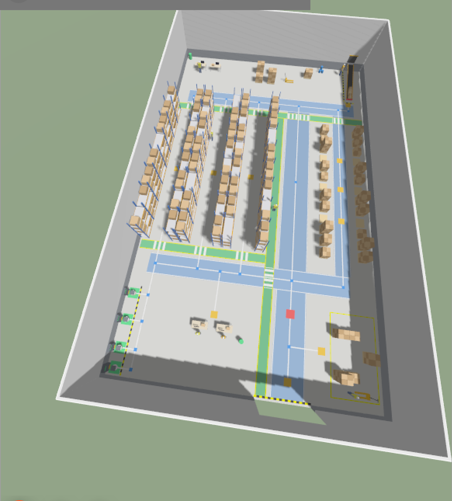
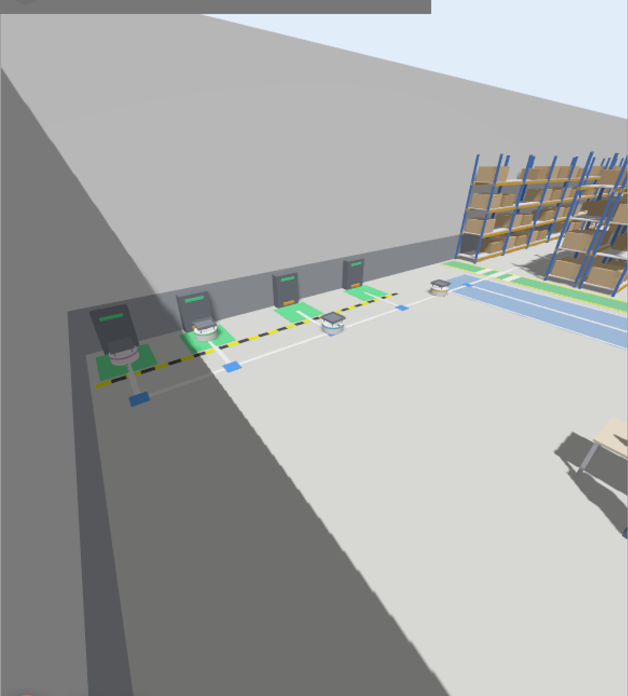
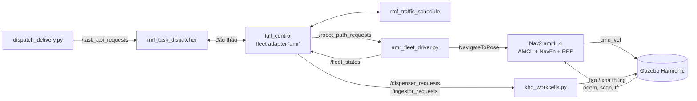
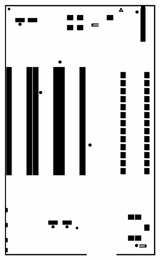

# warehouse-rmf-sim — Mô phỏng nhà kho với robot AMR, Nav2 và Open-RMF

Bài mô phỏng cho môn **Thiết kế Robot**: nhà kho dựng hoàn toàn bằng **URDF/Xacro**,
chạy trên **ROS 2 Humble + Gazebo Harmonic**. Có 4 robot AMR tự hành bằng **Nav2**, được
điều phối bởi **Open-RMF** để lấy hàng từ băng tải và giao tới khu chồng hàng hoặc khu xuất hàng.



## Nội dung

| Mô phỏng | Launch | Mô tả |
|---|---|---|
| Kho 50 m × 50 m | `warehouse_gazebo.launch.py` | Bản đầu tiên: 3 hành lang lấy hàng, băng tải nằm ngang, khu xếp pallet, đường đi vẽ trên sàn |
| Kho 30 m × 50 m | `kho_30x50.launch.py` | Phong cách [AWS small warehouse](https://github.com/aws-robotics/aws-robomaker-small-warehouse-world): 1 cửa, băng tải **dốc xuống gần mặt đất**, lane robot cạnh lối đi người, nhân viên, 4 trạm sạc |
| Kho 30 m × 50 m + RMF | `kho_rmf.launch.py` | Thêm 4 robot AMR (Nav2) + Open-RMF: đấu thầu nhiệm vụ, lập lịch tránh nhau, giao hàng, tự về sạc |

## Yêu cầu

- Ubuntu 22.04, **ROS 2 Humble**
- **Gazebo Harmonic** + `ros-humble-ros-gzharmonic` (cặp ROS ↔ Gazebo dùng trong repo này)
- Nav2: `ros-humble-navigation2 ros-humble-nav2-bringup`
- Phần lõi Open-RMF (chỉ cần cho `kho_rmf.launch.py`):

```bash
sudo apt install ros-humble-rmf-fleet-adapter ros-humble-rmf-fleet-adapter-python ros-humble-rmf-traffic-ros2 ros-humble-rmf-task-ros2 ros-humble-rmf-building-map-tools ros-humble-rmf-traffic-editor ros-humble-rmf-api-msgs ros-humble-rmf-dispenser-msgs ros-humble-rmf-ingestor-msgs ros-humble-rmf-fleet-msgs ros-humble-rmf-task-msgs
```

> **Đừng cài `ros-humble-rmf-dev`.** Gói này kéo theo Gazebo Classic 11, xung đột với Gazebo
> Harmonic. Repo này không dùng plugin mô phỏng của RMF (slotcar), mà tự viết fleet driver nối
> RMF với Nav2.

## Build

```bash
git clone https://github.com/hungnq676-sketch/warehouse-rmf-sim.git
cd warehouse-rmf-sim
source /opt/ros/humble/setup.bash
colcon build --symlink-install
source kho_env.sh
```

`kho_env.sh` source ROS + workspace và đặt `ROS_LOCALHOST_ONLY=1`. **Mọi terminal làm việc với
kho đều nên `source kho_env.sh`** (xem [Xử lý sự cố](#xử-lý-sự-cố)).

## 1. Kho 50 m × 50 m

```bash
ros2 launch warehouse_world warehouse_gazebo.launch.py            # Gazebo
ros2 launch warehouse_world warehouse_gazebo.launch.py rviz:=true # Gazebo + RViz
ros2 launch warehouse_world display.launch.py                     # chỉ RViz
```

Tham số: `aisle_width:=3.5`, `bays_per_row:=9`, `with_roof:=true`, `conveyor_speed:=0.3`, `headless:=true`.

- 4 dãy kệ (A đơn, B và C lưng–lưng, D đơn) tạo thành **3 hành lang lấy hàng** rộng 4 m, có biển màu đỏ / xanh lá / xanh dương.
- Góc Đông Bắc: băng tải chạy thật (TrackController) và đống thùng hàng động.
- Góc Tây Bắc: 8 pallet trống để xếp hàng.
- Phía Nam: 3 cửa xuất hàng, khu tập kết, bàn đóng gói, 3 trạm sạc.
- Đường đi robot vẽ trên sàn từ [`config/robot_paths.yaml`](src/warehouse_world/config/robot_paths.yaml).

## 2. Kho 30 m × 50 m

```bash
ros2 launch warehouse_world kho_30x50.launch.py                        # Gazebo
ros2 launch warehouse_world kho_30x50.launch.py rviz:=true             # + RViz
ros2 launch warehouse_world kho_30x50.launch.py animated_workers:=true # nhân viên đi lại
```

Gốc toạ độ ở tâm kho, x ∈ [-15, 15] (Tây → Đông), y ∈ [-25, 25] (Nam → Bắc).

| Thành phần | Vị trí |
|---|---|
| Cửa duy nhất | tường Nam, x ∈ [1.3, 7.3], rộng 6 m, cao 4.5 m |
| 4 dãy kệ (theo trục Y) | y ∈ [-9, 12.6]; x = -14.2 / -10.1 & -8.9 / -4.8 & -3.6 / 0.5 |
| 3 hành lang lấy hàng (rộng 3 m) | tâm x = -12.15, -6.85, -1.55 |
| Lane robot (nền xanh dương) | trục chính x ∈ [3, 6.6]; ngang Nam y ∈ [-13.4, -10.8]; ngang Bắc y ∈ [14.5, 17.1]; lane Đông x ∈ [10, 12] |
| Lối đi người (nền xanh lá, viền vàng) | chạy cạnh lane robot: x ∈ [1.4, 2.6]; y ∈ [13, 14.2]; y ∈ [-10.4, -9.2]; có vạch qua đường ở chỗ cắt nhau |
| **Băng tải dốc** (góc Đông Bắc) | x = 12.6; đầu cao y = 24.3, z = 1.3 m (lò cấp hàng trên tường) → đầu thấp y = 17.8, z = 0.35 m |
| Khu chồng hàng (phía Đông) | 2 cột pallet x = 8.6 / 13.4; ô trống cho robot xếp hàng tại `stack_1..3` |
| **4 trạm sạc** | tường Tây, (-13.9, -16 / -19 / -22 / -24): tủ sạc + đế sạc + vạch cảnh báo |
| Bàn đóng gói, khu xuất hàng, văn phòng | phía Nam / cạnh cửa / góc Tây Bắc |

- Nhân viên mặc định là khối hình học đứng yên, có collision nên lidar nhìn thấy.
- Với `animated_workers:=true`, 3 nhân viên đi lại trên lối đi người. Lần chạy đầu, Gazebo tải mô hình người từ Gazebo Fuel nên cần internet.
- Điều khiển băng tải: `ros2 topic pub --once /conveyor/speed std_msgs/msg/Float64 "{data: 0.2}"` (số dương = hàng chạy xuống, 0 = dừng).

## 3. Kho 30 m × 50 m + 4 robot AMR + Open-RMF

```bash
source kho_env.sh
ros2 launch warehouse_world kho_rmf.launch.py                  # 4 robot, Gazebo + RViz
ros2 launch warehouse_world kho_rmf.launch.py num_robots:=2    # máy yếu
ros2 launch warehouse_world kho_rmf.launch.py headless:=true show_rviz:=false
```

Chờ khoảng 40 giây cho Nav2 và RMF lên, rồi gửi nhiệm vụ giao hàng từ **một terminal khác**
(nhớ `source kho_env.sh`):

```bash
ros2 run warehouse_world dispatch_delivery.py -d stack_2                    # 1 nhiệm vụ
ros2 run warehouse_world dispatch_delivery.py -d stack_1 stack_3 ship_drop  # nhiều robot cùng lúc
ros2 run warehouse_world dispatch_delivery.py --auto 40                     # cứ 40 s gửi 1 nhiệm vụ
```

Một nhiệm vụ giao hàng diễn ra như sau:
1. RMF đấu thầu và chọn robot rảnh, phù hợp nhất.
2. Robot chạy tới `conv_pick` ở cuối băng tải.
3. Trạm `conveyor` đặt thùng lên khay robot, và lò cấp hàng thả một thùng mới lên đầu băng.
4. Robot chở hàng tới `stack_k` hoặc `ship_drop`.
5. Trạm `stack_area` / `shipping` xếp thùng lên pallet.
6. Robot về trạm sạc. Khi pin dưới 25%, RMF tự đưa robot đi sạc.



### Kiến trúc



| Thành phần | Vai trò |
|---|---|
| [`amr.urdf.xacro`](src/warehouse_world/urdf/amr.urdf.xacro) | Robot AMR thân tròn R = 0.3 m, vi sai 2 bánh, lidar 360°, khay chở hàng có viền |
| [`nav2_amr.yaml`](src/warehouse_world/config/nav2_amr.yaml) | Nav2 cho từng robot (namespace `/amrN`): AMCL, NavFn, Regulated Pure Pursuit |
| [`maps/kho_30x50.pgm`](src/warehouse_world/maps) | Bản đồ sinh **từ collision của URDF** bằng `make_map.py`, không cần SLAM |
| [`make_rmf_nav_graph.py`](src/warehouse_world/scripts/make_rmf_nav_graph.py) | Chuyển `kho_30x50_paths.yaml` thành nav graph của RMF. Vạch trên sàn và đồ thị RMF dùng chung một nguồn |
| [`amr_fleet_driver.py`](src/warehouse_world/scripts/amr_fleet_driver.py) | Cầu nối RMF ↔ Nav2: thực hiện lộ trình, chờ đúng giờ RMF hẹn, mô phỏng pin và sạc, vẽ marker trong RViz |
| [`kho_workcells.py`](src/warehouse_world/scripts/kho_workcells.py) | Dispenser `conveyor` và ingestor `stack_area`, `shipping`: tạo / xoá thùng hàng trong Gazebo |
| [`dispatch_delivery.py`](src/warehouse_world/scripts/dispatch_delivery.py) | Gửi nhiệm vụ giao hàng lên RMF |



## Đường đi robot và tùy biến

- Đường đi nằm trong [`kho_30x50_paths.yaml`](src/warehouse_world/config/kho_30x50_paths.yaml) (node + cạnh).
  Thêm hoặc sửa node rồi chạy lại launch là vạch trên sàn và nav graph của RMF đổi theo.
  - `junction`: ngã rẽ (ô xanh dương nhỏ)
  - `station`: điểm làm việc (ô cam)
  - `home`: điểm xuất phát (ô đỏ)
  - `charge`: trạm sạc
- Sửa hình học kho xong thì sinh lại bản đồ Nav2:

```bash
python3 src/warehouse_world/scripts/make_map.py \
  --xacro src/warehouse_world/urdf/kho_30x50.urdf.xacro \
  --out src/warehouse_world/maps/kho_30x50 --extra-box=12.2,17.8,13.0,24.3
```

- Màu sắc nằm trong bảng `colors` của [`warehouse_macros.xacro`](src/warehouse_world/urdf/warehouse_macros.xacro).
  Khi thêm vật, dùng `<xacro:mat n="ten_mau"/>`, **không** dùng `<material name="..."/>`.

## Cấu trúc thư mục

```
warehouse-rmf-sim/
├── kho_env.sh                     # source ROS + workspace, ROS_LOCALHOST_ONLY=1
├── docs/images/
└── src/warehouse_world/
    ├── urdf/      warehouse*.xacro, kho_*.xacro, amr, conveyor, cargo_box
    ├── worlds/    warehouse.sdf, kho_30x50.sdf, kho_30x50_actors.sdf
    ├── config/    robot_paths.yaml, kho_30x50_paths.yaml, nav2_amr.yaml
    ├── maps/      kho_30x50.pgm/.yaml
    ├── launch/    warehouse_gazebo, display, kho_30x50, kho_rmf
    ├── rviz/      warehouse.rviz, kho_rmf.rviz
    └── scripts/   amr_fleet_driver, kho_workcells, dispatch_delivery, make_map, make_rmf_nav_graph
```

## Xử lý sự cố

- **Log báo "Detected jump back in time", robot không chạy.** Một máy khác trong cùng mạng LAN
  đang chạy ROS 2 trên cùng domain và phát `/clock` riêng. `kho_rmf.launch.py` đã đặt sẵn
  `ROS_LOCALHOST_ONLY=1`. Các terminal dùng `ros2 run` / `ros2 topic` cũng phải `source kho_env.sh`,
  nếu không chúng sẽ không thấy hệ thống.
- **`dispatch_delivery.py` báo "Khong thay RMF dispatcher".** Terminal đó chưa `source kho_env.sh`,
  hoặc `kho_rmf.launch.py` chưa chạy xong.
- **Vật thể trong Gazebo bị đen.** Trình chuyển URDF → SDF chỉ gán màu theo tên cho visual đầu
  tiên của mỗi link. Dùng macro `xacro:mat` để ghi màu trực tiếp.
- **Mô phỏng chậm** (thời gian thực khoảng 30–40% với 4 robot). Giảm `num_robots`, hoặc chạy `headless:=true`.

## Hạn chế đã biết

- AMCL có thể lệch khoảng 0.5 m theo chiều dọc ở các hành lang dài, ít đặc điểm.
- Thùng hàng chỉ nằm trên khay nhờ ma sát, không gắn khớp với robot.
- Pin là mô phỏng trong `amr_fleet_driver.py`; thông số đã chỉnh khớp với mô hình pin khai cho RMF.
- `animated_workers:=true` chưa được kiểm thử đầy đủ (cần tải mesh từ Gazebo Fuel).

## Giấy phép

[MIT](LICENSE) © 2026 Nguyễn Quang Hưng
